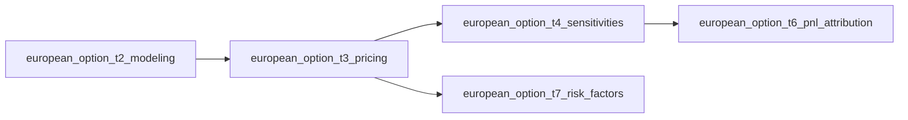

# Mermaid diagrams for structure

Read before adding or reviewing any diagram. Mermaid shows **structure**: how pieces connect, in what order, who pays whom, which branch to take. Equations say what is true and matplotlib shows how big it is, but neither shows the shape of the machine. A good diagram lets the reader hold the whole architecture, or the whole desk workflow, in their head before the formulas and code arrive.

## Contents
1. Mermaid or matplotlib?
2. Rules (non-negotiable)
3. Design principles
4. Visual vocabulary
5. Which diagram type for which job
6. Diagram menu per theme
7. Where diagrams go in a notebook
8. Patterns
9. Series-level diagrams (README)
10. Verification
11. Anti-patterns

---

## 1. Mermaid or matplotlib?

| The picture shows... | Use |
|---|---|
| Quantities on axes: payoffs, curves, Greeks, distributions, exposure profiles, P&L | matplotlib (`common/plotting.py`) |
| Boxes and arrows: layers, object dependencies, pipelines, decision trees, hierarchies | Mermaid |
| Who pays whom, when, with which trigger (swap legs, margin calls, default) | Mermaid `sequenceDiagram` |
| A life cycle or states (hedge loop, barrier knock-in, margin call, default) | Mermaid `stateDiagram-v2` |
| Dates on a line (contract life cycle, MPoR window, backtest horizon) | Mermaid `timeline`, or matplotlib if dates must be to scale |

Never draw a data chart in Mermaid (no `pie`, `xychart-beta`, `quadrantChart`): it cannot show the calibrated numbers and would bypass the plotting standards. The Mermaid hard rule is an addition to the series rules, not an exception: still no `mo.ui.*`, still matplotlib for every plot of data.

## 2. Rules (non-negotiable)

- **Render with `diagram()` from `common/diagrams.py`** (a thin wrapper over `mo.mermaid`). A ```` ```mermaid ```` fence inside `mo.md` does **not** render in marimo (checked on 0.25.2: it prints as a code block). Fences are correct only in plain Markdown files such as `notebooks/README.md`.
- **Static only.** No `click`, `callback` or `link` directives, no widgets. `diagram()` rejects them.
- **Plain string, never an f-string.** Mermaid uses `{ }` for decision nodes and `{{ }}` for hexagons (the series does not use hexagons; `diagram()` rejects `{{`). To insert values use `string.Template(...).substitute(...)` (`$name`) or concatenation. Prefer fixed text: a diagram with live numbers is usually a plot in disguise.
- **No LaTeX and no HTML inside diagram labels** (the one exception is `<br/>` for a line break). Write `sigma`, `V(t)`, `tau_i` or Unicode (σ, Δ, Γ); keep real math in `mo.md`. Use the series notation table; never invent a new symbol in a diagram.
- **Use only stable diagram types:** `flowchart`, `sequenceDiagram`, `classDiagram`, `stateDiagram-v2`, `timeline`, `mindmap`, `erDiagram`, `gantt`. The `*-beta` types depend on the Mermaid version bundled with marimo and may not render.
- **Every diagram has a caption** (the `caption` argument) stating the takeaway in one sentence. Diagrams are drawn by the browser, so a text export, script run or `marimo export ipynb` shows nothing: prose and caption must carry the message alone.
- **Validate before delivering** (`scripts/check_mermaid.py`, section 10). Mermaid syntax errors do not fail `python notebook.py`, `marimo check` or `marimo export html`; they show up only as a red error box in the reader's browser.

## 3. Design principles

1. **One diagram, one idea.** If the caption needs "and", split it.
2. **Small.** At most about 12 nodes and 3 levels of nesting. Beyond that the reader decodes instead of understanding: split, or collapse detail into a single node that the next diagram expands.
3. **Budget: 2 to 5 diagrams per notebook.** Each must show something the prose and plots do not. Decoration is a cost.
4. **Advance organiser first.** Place the diagram *before* the text and code it organises, so the reader knows where each cell fits. Optionally repeat it once in the Summary with what was covered highlighted.
5. **Draw the real objects.** Label nodes with the actual QuantLib classes and published function names (`BlackScholesMertonProcess`, `price_european`), so the diagram doubles as a map from concept to code.
6. **Mark provenance.** Use a subgraph titled with the source module for code imported from an earlier notebook, and another titled "new in this notebook". This makes the import-don't-copy rule visible.
7. **Direction carries meaning.** `LR` for process and time, `TB` for hierarchy and decision. Main path left to right or top to bottom.
8. **Label the edges that matter.** "Handle", "reprices on setValue", "if payoff is path-dependent". An unlabeled arrow hides the relationship that is the lesson.
9. **Consistent vocabulary across the series** (next section). The colours are familiar after the first notebook.

## 4. Visual vocabulary

`diagram()` appends these classes to `flowchart` / `graph` / `stateDiagram` sources. Apply with `class A,B instrument` or `A:::instrument`. One meaning per colour, series-wide. They match the Okabe-Ito hues of the plots and keep dark text so they read in light and dark mode.

| Class | Meaning | Hue |
|---|---|---|
| `instrument` | contract, payoff, cash flow, leg | sky blue |
| `market` | curve, quote, vol surface, handle, data | orange |
| `model` | stochastic process, calibration, risk-factor dynamics | purple |
| `engine` | pricing engine, numerical method, simulator | green |
| `output` | NPV, Greek, exposure, VaR, CVA, any result | yellow |
| `risk` | risk event, limit, default, breach, warning | vermillion |
| `neutral` | anything else, grouping | grey |

The first four are the four layers of the QuantLib implementation (instrument / market data / model / engine). Keep them in this order and these colours in every notebook.

Shapes and arrows:

| Mermaid | Use for |
|---|---|
| `A[text]` | an object, step or concept |
| `A([text])` | start, end or a final result |
| `A[(text)]` | stored or market data |
| `A[[text]]` | a published function from `@app.function` |
| `A{text}` | a decision |
| `A --> B` | flow of data, calls, time |
| `A ==> B` | the main path to follow |
| `A -.-> B` | optional, approximate or conceptual dependency |

## 5. Which diagram type for which job

| Type | Best for | Example |
|---|---|---|
| `flowchart` | pipelines, layer stacks, decision trees, hierarchies, object graphs | contract-to-NPV pipeline; "which engine?" tree; netting-set hierarchy |
| `sequenceDiagram` | ordered exchanges between parties | swap cash flows; margin call and return; default waterfall; hedge trade vs client trade |
| `classDiagram` | structural relations between QuantLib types | `Instrument` / `PricingEngine` / `Process` / `Handle<Quote>` |
| `stateDiagram-v2` | life cycles and loops | hedge rebalance loop; knock-in barrier; margin call lifecycle; survival or default |
| `timeline` | dated milestones | contract life cycle; margin period of risk; backtest window |
| `mindmap` | taxonomies, kept to 2 levels | the XVA family; risk-factor classes |

`erDiagram` and `gantt` exist but rarely show more than the above; use only with a specific reason.

## 6. Diagram menu per theme

One **must-have** per theme, then optional ones within the budget. Adapt to the instrument.

| Theme | Must-have | Optional |
|---|---|---|
| T1 Product anatomy | Parties and legs: who pays what to whom (`sequenceDiagram` or `flowchart LR`) | Contract life cycle (`timeline`); term-sheet field map |
| T2 QuantLib modeling | Object dependency graph: Quote -> Handle -> TermStructure -> Process (`flowchart LR`) | Four-layer stack; instrument class hierarchy (`classDiagram`) |
| T3 Pricing | Contract-to-NPV pipeline across the four layers, imported vs new | "Which engine?" decision tree (analytic / PDE / MC); valuation chain (payoff -> expectation under Q -> discounting) |
| T4 Sensitivities | Greek family map: what each is the derivative with respect to; which are analytic vs bumped | Bump-and-reval workflow with restore; dependence between Greeks |
| T5 Hedging | Rebalancing loop as `stateDiagram-v2` (observe, compute delta, trade, accrue, repeat) | Hedge instrument selection (delta only / + gamma / + vega) |
| T6 P&L attribution | Attribution pipeline: two-date revaluation -> Taylor terms -> residual | Full revaluation vs sensitivity-based side by side |
| T7 Risk factors | Factor hierarchy: asset class -> model -> calibration instruments | Correlation and simulation pipeline; model choice tree |
| T8 Market risk | VaR pipeline: scenarios -> revaluation -> P&L distribution -> VaR / ES | Choice tree: historical / MC / delta-gamma; backtest classification |
| T9 CCR | Exposure pipeline: simulate factors -> reprice on time grid -> max(V,0) -> EE / PFE / EPE / EEPE | Exposure for linear vs optional products; wrong-way risk links |
| T10 Netting and collateral | Netting-set hierarchy, with and without the netting agreement | Margin call lifecycle (`sequenceDiagram`); margin period of risk (`timeline`) |
| T11 XVA | XVA stack: CVA / DVA / FVA / MVA / KVA and what each prices (`flowchart` or `mindmap`) | Cash-flow sequence between bank, counterparty and funding desk; dependency on exposure, credit and funding inputs |
| T12 Market data and calibration | Market-data pipeline: raw quotes -> cleaning -> helpers -> curve or surface -> calibrated model -> snapshot (`flowchart LR`) | Calibration loop (`stateDiagram-v2`); curve-build dependency graph |
| T13 Valuation control and model risk | Valuation-control workflow: price-source hierarchy -> tolerance -> escalate -> reserve (`flowchart`) | Model lifecycle (`stateDiagram-v2`); which model for which payoff (decision tree) |
| T14 Regulatory capital and margin | Capital data flow: sensitivities, scenarios and exposures -> methods -> reports (`flowchart LR`) | P&L attribution decision flow; margin call lifecycle (`sequenceDiagram`) |

### 6b. Desk workflow diagram (section 6 of every notebook)

One `flowchart LR` with two subgraphs, "Front office" and "Middle office". Nodes are the published functions and the desk outputs (`output` class); the control is a decision node; the failure branch uses the `risk` class and ends in an action ("escalate for re-mark"). Examples by theme: T3 IPV (desk mark vs independent engine), T6 P&L explain sign-off, T8 limit breach escalation, T9 pre-trade credit check, T10 margin call and dispute, T11 pre-trade XVA quote, T12 snapshot sign-off, T13 reserve escalation, T14 P&L attribution zone and desk eligibility. The template shows the T3 version.

## 7. Where diagrams go in a notebook

By section name (see the skeleton in `SKILL.md`):

- **Header:** optional diagram of this notebook's place in the series (prerequisites -> this -> next). Only if it adds beyond the Previously / Next links.
- **Theory:** the conceptual diagram that frames the mathematics, placed before it (valuation chain, cash-flow structure).
- **QuantLib implementation:** the architecture diagram first, with imported vs new code made visible (the diagram most often missing and most valuable), then the engine-choice tree just before the cell that sets the engine.
- **Exploration:** a decision tree if the sweeps lead to a choice ("which engine for which payoff").
- **Front and middle office applications:** one workflow diagram with subgraphs "Front office" and "Middle office": who produces each output, who consumes it, where the control sits, where breaches go (see section 6b).
- **Pitfalls:** a diagram only when the pitfall is about structure (e.g. evaluation-date ordering as a sequence).
- **Summary:** optional recap of the Header or architecture diagram with the covered part highlighted.

## 8. Patterns

Import: `from common.diagrams import diagram`. Output is the last expression of a `@app.cell` (it renders; do not call `print`).

**Four-layer pipeline with provenance** (T3 and later):

```python
@app.cell(hide_code=True)
def _():
    diagram("""
    flowchart LR
      subgraph IMP["imported from european_option_t2_modeling"]
        direction TB
        I[VanillaOption<br/>payoff, exercise]:::instrument
        M[(FlatForward<br/>BlackConstantVol)]:::market
      end
      subgraph NEW["new in this notebook"]
        direction TB
        P[BlackScholesMertonProcess]:::model
        E[[AnalyticEuropeanEngine]]:::engine
      end
      M --> P --> E
      I -- setPricingEngine --> E
      E ==> V([NPV, Greeks]):::output
    """, caption="Instrument and market come from T2; this notebook adds the model and engine.")
    return
```

**Who pays whom** (T1):

```python
diagram("""
sequenceDiagram
  participant A as Bank (payer fixed)
  participant B as Counterparty (payer float)
  loop each period i
    A->>B: N * tau_i * K
    B->>A: N * tau_i * L_i
  end
  Note over A,B: only the net amount is exchanged
""", caption="A vanilla swap is two opposite coupon streams, netted per payment date.")
```

**Decision tree** (T3 or Exploration):

```python
diagram("""
flowchart TB
  S{Payoff path-dependent?}
  S -- no --> C{Closed form under the model?}
  C -- yes --> A[[Analytic engine]]:::engine
  C -- no --> F[[PDE or tree]]:::engine
  S -- yes --> D{Early exercise?}
  D -- no --> M[[Monte Carlo]]:::engine
  D -- yes --> L[[Least-squares MC or PDE]]:::engine
""", caption="Pick the cheapest engine that is exact for the payoff and the model.")
```

**Loops and life cycles** (T5, T10): `stateDiagram-v2` with transitions labeled by trigger (`delta outside band`, `margin call`, `default`).

Interpolating a value, when truly needed:

```python
from string import Template
src = Template("flowchart LR\n  A[strike $k] --> B[NPV]").substitute(k=f"{params['strike']:.0f}")
diagram(src, caption="...")
```

## 9. Series-level diagrams (README)

`notebooks/README.md` is plain Markdown (GitHub renders ```` ```mermaid ```` fences there). Besides the table of order, module, theme, imports and published code, include **one `flowchart LR` import graph**: one node per notebook module, an arrow from each module to the modules that import its code, node text `module` plus theme code. Update it with every new notebook. It shows at a glance what a reader must have seen and what a change would break, which the table hides.



## 10. Verification

1. Run `python scripts/check_mermaid.py notebooks/<notebook>.py`. It runs the notebook, records every `diagram()` source, and parses each with the real Mermaid parser. One-time setup: `cd scripts && npm install` (needs Node). Exit code 2 means the Node parser is unavailable and only the structural lint ran; say so rather than reporting the syntax as checked.
2. The bundled Mermaid in marimo can differ from the parser version in `scripts/package.json`; keep to stable types and basic syntax so the difference does not matter.
3. The checker cannot judge layout (overlap, tiny text, oversize). If you can open the rendered notebook (`marimo export html`, then view), do; otherwise list "diagram layout not visually reviewed" among the checks not run.
4. For README graphs: check that every notebook module in `notebooks/` appears, and every arrow matches an actual import.

## 11. Anti-patterns

- A diagram that restates a sentence ("A leads to B leads to C") with no structure to add.
- More than about 12 nodes, or crossing arrows everywhere. Split.
- Diagrams used to decorate the Header or to pad a section.
- Data in Mermaid (a `pie` of XVA components, an `xychart-beta` of exposure): matplotlib.
- Colours with private meanings per notebook. Colours are series vocabulary.
- Different names in the diagram and in the code (`BSMProcess` vs `BlackScholesMertonProcess`).
- A diagram whose message is missing from the caption and prose.
- f-strings around Mermaid source, LaTeX in labels, `click` handlers, ```` ```mermaid ```` fences in `mo.md`.
- Re-drawing an earlier notebook's diagram instead of linking to it. Draw the new part, mention the old.
